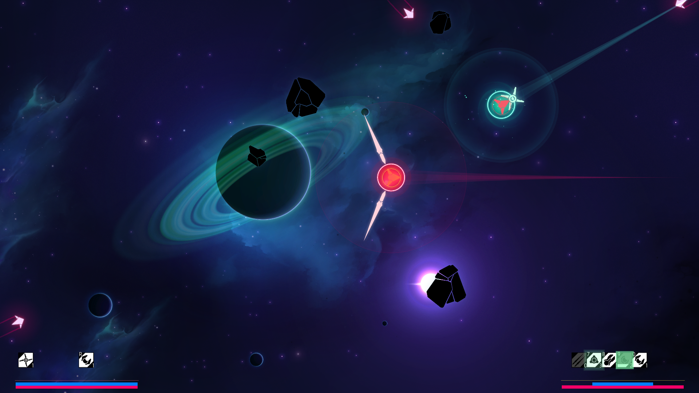
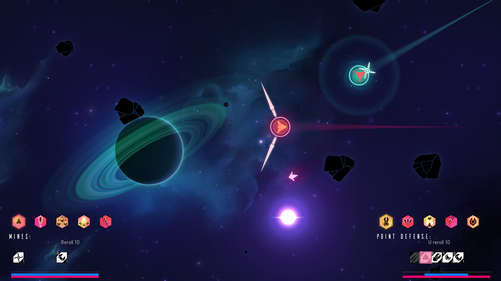
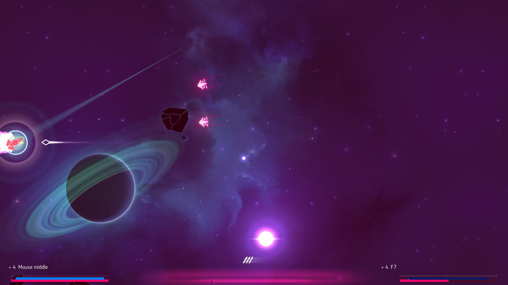

# Nova Drift Co-op

A two-player co-op mod for Nova Drift. Each player controls their own ship and
chooses their own upgrades. XP is shared. Supports local play and Steam Remote
Play Together.

## Features

- Separate weapons, shields, bodies, augments and rerolls for each player.
- Upgrade choices can be saved for later and used during combat.
- A larger arena, more enemies in regular waves, and enemies that target both players.
- Revive a teammate at their beacon without resetting their build.
- The game's HUDs, upgrade artwork and descriptions, with red and gold player colors.

## Upgrades

Small upgrade strips sit beside each player's HUD, leaving the arena visible.
Both players can browse at once, or one can keep fighting while the other chooses.
Hover a hex or hold Inspect to reveal its [full description](docs/screenshots/upgrade-inspect.png). Combat stays live.

## Revival

When a player dies, their ship leaves a beacon. After a short delay, the other
player can stay near it for three seconds to revive them. Their build is preserved.
The arena resizes as players join, die and revive. If both players die, the run ends.

## Installation

Requires **Nova Drift 1.2.38.4 on Steam, Windows x64**. This is an experimental,
source-only mod; the game and compiled mod files are not included.

1. Follow the [installation guide](docs/INSTALLATION.md) to build and set up your co-op copy.
2. Open `PlayCoop.cmd` in `%USERPROFILE%\Games\NovaDriftCoop`.
3. Start a **fresh run**. The second ship joins automatically.

For online play, follow the [Steam Remote Play setup](README.RemotePlay.md), then
open `PlayRemoteCoop.cmd` and invite your friend. Steam shows the session as **Spacewar**.

Your original Steam installation and saves stay separate from the co-op copy.

## Controls

| | Player 1 · red | Player 2 · gold |
|---|---|---|
| Move | Mouse aim + left button thrust | I / J / K / L |
| Fire | Right mouse button | N |
| Open upgrades | Middle mouse button | F7 |
| Inspect an upgrade | Hover its hex | Hold O |
| Choose an upgrade | Left click | N |

Press **F6** to configure P2. **Escape** pauses the game for both players.
See [all controls](docs/CONTROLS.md) for rerolls, constructs and controller mappings.

Initial weapon, shield and body choices use the original selection screen.
Two-player save/resume is not supported. See [tested features and known limits](docs/VALIDATION.md).

---

[Installation](docs/INSTALLATION.md) · [Steam Remote Play](README.RemotePlay.md) ·
[Controls](docs/CONTROLS.md) · [Balance](docs/BALANCE.md) ·
[Development](docs/DEVELOPMENT.md) · [Third-party notices](docs/THIRD_PARTY.md)
